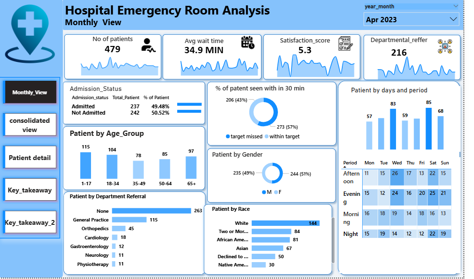

# Hospital Emergency Room Analysis | Power BI

## Project Overview

The Hospital Emergency Room Analysis project is an interactive Power BI dashboard developed to analyze emergency room operations, patient flow, waiting times, admission patterns, patient satisfaction, and peak demand periods.

The objective is to transform raw healthcare data into actionable insights that can help healthcare administrators improve operational efficiency, optimize staff allocation, manage patient flow, and enhance the patient experience.

## Project Objectives

- Analyze total patient visits and emergency room activity.
- Monitor average patient waiting time against the 30-minute target.
- Evaluate patient admission and non-admission rates.
- Identify peak patient demand by day, time, and shift.
- Understand patient demographics and departmental referral patterns.
- Develop data-driven recommendations to improve emergency room operations.

## Tools and Technologies

- Power BI for interactive dashboards, KPI monitoring, and data visualization.
- Power Query for data cleaning, transformation, and preparation.
- DAX for measures and operational KPI calculations.
- Microsoft Excel for data inspection and preliminary analysis.

## Dashboard Preview

### Monthly View

Analyzes patient volume and emergency room performance over time to identify monthly trends and variations in demand.

### Consolidated View

Presents an overview of key performance indicators, including total patients, average waiting time, patient satisfaction, and admission status.

### Patient Details

Provides a detailed view of patient information to explore demographic patterns and admission outcomes.

### Key Takeaways

Summarizes the major analytical findings and highlights opportunities for improving emergency room performance.

### Recommendations

Presents actionable recommendations to support staffing decisions, patient flow management, and resource planning.

## Dataset Information

|
